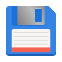

<div align="center">
  
  <h1>SaveDesktop Plus</h1>
  <p><i>Save your desktop configuration</i></p>

  
  
  
</div>

## 🚀 About

**SaveDesktop Plus** is a preview fork of [SaveDesktop 4.1 by vikdevelop](https://github.com/vikdevelop/SaveDesktop/tree/4.1).
The 2026-11-26 changes establish independent Flatpak packaging and settings.
The [GPL-3.0-or-later license](LICENSE) applies to the application.
The original icon artwork by Brage Fuglseth is reused under [CC BY-SA 4.0](https://creativecommons.org/licenses/by-sa/4.0/). The [upstream SVG source](data/icons/io.github.vikdevelop.SaveDesktop.Source.svg) and icon artwork are unchanged; only the installed icon filenames differ.

SaveDesktop Plus is a cross-desktop tool to **back up, restore and sync your entire Linux desktop setup**.
It can save your themes, icons, fonts, settings, wallpapers (even dynamic ones), Flatpak apps and user data – and bring them back in just a few clicks.

## Preview safety

The fork preserves both SaveDesktop installations and their Flatpak data during its cleanup.
Upstream SaveDesktop 4.1 has its own cleanup. When both versions are installed, keep
**Keep existing Flatpak apps and data** enabled in the original before importing there,
including through synchronization, or skip Flatpak restoration in the original.
Use distinct backup destinations when configuring both applications.

## 📸 Screenshots

| Save Page | Import Page | Sync Page |
|-------------|-------------|-----------|
|  <br><sub>Save your setup</sub> |  <br><sub>Restore from backup</sub> |  <br><sub>Sync with other computers through the cloud</sub> |

## ✨ Features

- Backup your **icons, themes, fonts and wallpapers**
- Save **desktop settings** across environments
- Include **Flatpak apps and user data**
- Restore everything in one click
- Sync with cloud folders
- Works with **GNOME, KDE Plasma, Xfce, Cinnamon, Budgie, COSMIC (GNOME and Rust version), Pantheon, MATE, Deepin, LXQt, Niri** and **Hyprland**

<details>
  <summary><b>Full list of supported desktops & directories</b></summary>

  - **General directories**
  ```
  - ~/.config/dconf
  - ~/.config/gtk-4.0 
  - ~/.config/gtk-3.0
  - ~/.themes
  - ~/.icons
  - ~/.fonts
  - ~/.local/share/themes
  - ~/.local/share/icons
  - ~/.local/share/fonts
  - ~/.local/share/backgrounds 
  - ~/.local/share/gnome-shell
  - ~/.local/share/plasma
  - ~/.local/share/cinnamon
  - ~/.local/share/flatpak/app
  - ~/.var/app
  - /var/lib/flatpak/app
  ```
  - **GNOME**
  ```
   - ~/.local/share/gnome-background-properties
   - ~/.local/share/nautilus-python
   - ~/.local/share/nautilus
   - ~/.config/gnome-control-center
  ```
  - **Pantheon**
  ```
  - ~/.config/plank 
  - ~/.config/marlin 
  ```
  - **Cinnamon**
  ```
  - ~/.config/nemo
  - ~/.cinnamon
  ```
  - **Budgie**
  ```
  - ~/.config/budgie-desktop
  - ~/.config/budgie-extras
  - ~/.config/nemo
  ```
  - **Cosmic (Old)**
  ```
  - ~/.config/pop-shell
  - ~/.local/share/nautilus
  ```
  - **Cosmic (New)**
  ```
  - ~/.config/cosmic
  - ~/.local/state/cosmic
  ```
  - **Xfce**
  ```
  - ~/.config/xfce4
  - ~/.config/Thunar
  - ~/.xfce4
  ```
  - **MATE**
  ```
  - ~/.config/caja
  ```
  - **KDE Plasma**
  ```
  - ~/.config/[k]* (all directories and files beginning with k)
  - ~/.config/gtkrc
  - ~/.config/dolphinrc
  - ~/.config/gwenviewrc
  - ~/.config/plasmashellrc
  - ~/.config/spectaclerc
  - ~/.config/plasmarc
  - ~/.config/plasma-org.kde.plasma.desktop-appletsrc
  - ~/.local/share/[k]* (all directories and files beginning with k)
  - ~/.local/share/konsole
  - ~/.local/share/dolphin
  - ~/.local/share/sddm
  - ~/.local/share/wallpapers
  - ~/.local/share/plasma-systemmonitor
  - ~/.local/share/aurorae
  - ~/.local/share/kscreen
  - ~/.local/share/color-schemes
  ```
  - **Deepin**
  ```
  - ~/.config/deepin
  - ~/.local/share/deepin
  ```
  - **LXQt**
  ```
  - ~/.config/lxqt
  ```
  - **Niri**
  ```
  - ~/.config/niri
  ```
  - **Hyprland**
  ```
  - ~/.config/hypr
  ```
</details>

## Installation

SaveDesktop Plus is available as an x86_64 preview bundle built by the GitHub Actions
workflow. Download its artifact and verify `SHA256SUMS`, then install in your user account:

```sh
flatpak remote-add --user --if-not-exists flathub https://flathub.org/repo/flathub.flatpakrepo
flatpak install --user flathub org.gnome.Platform//50
flatpak install --user ./SaveDesktop-Plus-x86_64-preview.flatpak
flatpak run io.github.ivanniks_sudo.SaveDesktopPlus//preview
```

The original SaveDesktop is available on [Flathub](https://flathub.org/apps/io.github.vikdevelop.SaveDesktop).
The Snap manifest in this repository is retained for the upstream project.

## 🤝 Contributing

I welcome contributions of all kinds!

* **Code** → see [CONTRIBUTING.md](https://github.com/vikdevelop/SaveDesktop/blob/main/CONTRIBUTING.md)
* **Translations** → contribute via Weblate:

  | App                                                                                                                                                                                      | Wiki                                                                                                                                                                                                             |
  | ---------------------------------------------------------------------------------------------------------------------------------------------------------------------------------------- | ---------------------------------------------------------------------------------------------------------------------------------------------------------------------------------------------------------------- |
  | <a href="https://hosted.weblate.org/projects/vikdevelop/savedesktop/"></a> | <a href="https://hosted.weblate.org/projects/vikdevelop/savedesktop-github-wiki/"></a> |
* **Issues & bugs** → [GitHub Issues](https://github.com/vikdevelop/SaveDesktop/issues) or [Open issue without GitHub](https://vikdevelop.github.io/SaveDesktop/issue-report/)
* **Discussions** → [GitHub Discussions](https://github.com/vikdevelop/SaveDesktop/discussions)

This project follows the [GNOME Code of Conduct](https://conduct.gnome.org).

## 📜 License

Save Desktop is licensed under the [GPL-3.0 License](LICENSE).
